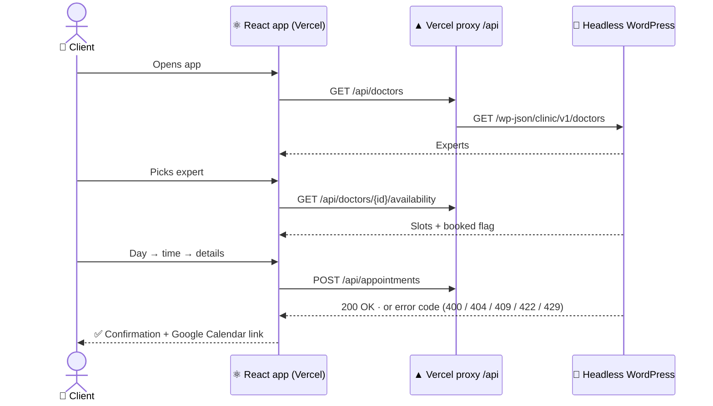

<div align="center">

# 📅 Book.it — Frontend

**Book.it is a lightweight appointment booking app: pick an expert, pick a free slot, book in under a minute.**
This repo is the **user-facing React app**. It talks to a **headless WordPress** backend, which is a [🔗 custom plugin with a REST API](https://github.com/chomontbartosz/bookit-backend).

[🚀 **Live demo**](https://bookit-frontend-wheat.vercel.app) · [🧩 Backend repo](https://github.com/chomontbartosz/bookit-backend)


</div>

---

## 💡 Concept

|---|---|
| 😩 **Problem** | Small businesses (clinics, consultants, coaches) book visits / consultations by phone or email, which is too slow, error-prone, and closed outside office hours. |
| ✅ **Solution** | A scalable self-service booking page that shows only **real, free slots**, backed by a CMS the staff already knows (WordPress). Works perfect for solo entrepreneuers as well as large clinics. |
| 👥 **For whom** | **Clients** book in a few clicks, no account needed. **Staff** manage experts and see bookings in the familiar WP admin. |

---

## ✨ Features

- 👩‍⚕️ **Expert list**: name, specialization and visit length, fetched live
- 🗓️ **Monthly calendar**: only days with free slots are clickable; past months are locked; today is marked
- ⏰ **Time picker**: free, future times for the chosen day
- 📝 **Booking form**: labelled fields, email check on blur, the button stays disabled until the form is valid and while it's sending
- 🛡️ **Clear feedback**: every API error code (`slot_taken`, `past_date`…) has a human message; a taken slot sends you back to the times, already refreshed
- 📲 **"Add to Google Calendar"**: correct start time and length, no login or API key
- 🌍 **EN / PL switcher** (flag + chevron, top right): texts, dates, weekday names and week start all follow the language; the choice is remembered
- ⏳ **Loading, empty and error states** with a "Try again" button
- ♿ **Accessible**: real buttons, labels, `aria-live` messages, keyboard focus styles
- 📱 **Responsive**, mobile-first

---

## ⚙️ How it works



**Flow:** `DoctorList` → `MonthCalendar` → `TimeSlotPicker` → `BookingForm` → `BookingConfirmation`

The **backend is the source of truth** for availability and booking rules. The frontend only displays what the API returns and translates its error codes.

---

## 🧠 Technical decisions

| Decision | Why |
|---|---|
| 🔀 **Headless WordPress** + React SPA | Staff keep the WP admin they know; the client UI is fast and deploys on its own schedule. Either side can be replaced without touching the other. |
| ▲ **Vercel rewrite as API proxy** (`vercel.json`) | The browser only talks to the app's own HTTPS domain: no mixed content, no CORS, and the backend address isn't shipped in the code. |
| 🌍 **i18n in JSON + a tiny provider** (no library) | Translators edit plain JSON. TypeScript checks that every locale has every key (`satisfies Messages`), so a missing translation fails the build. |
| 📅 **Dates via `Intl`, not translations** | Month names, weekdays and long dates come from the browser's `Intl` API in the chosen language: zero hand-written date strings. |
| 🕐 **Local date keys** (`toDateKey`) | `toISOString()` converts to UTC and shifts the day in Europe. All dates go through one helper. |
| 🧩 **API error codes → i18n keys** | The backend returns stable codes; `errors.<code>` holds the message in each language. No string matching. |
| 🎨 **One stylesheet** with design tokens + component classes | Colours and visuals live in `styles/index.css` (`.btn-primary`, `.calendar-day`…); components only add layout utilities. Rebranding = editing one file. |
| 🧮 **Pure helpers in `lib/`** | Date maths, slot grouping, validation and calendar links are plain functions: easy to test and reuse, no React inside. |
| 🪝 **`useFetch` hook** (no data library) | Three endpoints don't justify React Query. One hook covers loading, error, retry, and keeps old data on screen while refreshing. |
| ⚡ **Vite + React 19 + strict TypeScript** | Instant dev server, small bundle, typed API contracts. |

---

## 🗂️ Project structure

Every concern has **exactly one home**. Everything else imports it.

```text
├── index.html                    🚪 HTML shell: meta, favicon
├── vercel.json                   ▲ /api/* → WordPress REST API proxy
├── public/
│   ├── favicon.svg
│   └── flags/                    🏳️ gb.svg, pl.svg
└── src/
    ├── main.tsx                  🚪 Entry: mounts <App /> inside <I18nProvider>
    ├── App.tsx                   🧱 Shell: header + current screen
    ├── config.ts                 ⚙️ All constants and env values
    ├── env.d.ts                  🏷️ Types for import.meta.env
    ├── types/
    │   └── index.ts              🏷️ All types: API wire format + app models
    ├── api/
    │   └── clinicApi.ts          🔌 All HTTP calls + ApiError
    ├── hooks/
    │   ├── useFetch.ts           🪝 Generic loading / error / retry
    │   └── useClinicData.ts      🪝 useDoctors, useAvailability
    ├── lib/                      🧮 Pure functions, no React
    │   ├── date.ts               🕐 Date keys, month grid, Intl formats
    │   ├── slots.ts              ⏰ Free slots grouped by day
    │   ├── validation.ts         ✅ Email / required checks
    │   ├── googleCalendar.ts     📲 "Add to calendar" URL
    │   └── cx.ts                 🧵 Class name joiner
    ├── i18n/
    │   ├── locales/en.json       🇬🇧 All English texts (reference)
    │   ├── locales/pl.json       🇵🇱 All Polish texts
    │   ├── locales.ts            🌍 Supported languages, key types, translate()
    │   ├── I18nContext.ts        🪝 useI18n()
    │   └── I18nProvider.tsx      🌍 Current language, t(), formatDate()
    ├── styles/
    │   └── index.css             🎨 All styles: tokens → base → components
    └── components/
        ├── Header.tsx            🔝 Logo + language switcher
        ├── LanguageSwitcher.tsx  🌍 Flag + chevron dropdown
        ├── StatusMessage.tsx     💬 Loading / empty / error / success
        ├── BackButton.tsx        ← Shared back link
        ├── icons.tsx             🖼️ All SVG icons
        └── booking/
            ├── DoctorList.tsx          1️⃣ Choose an expert
            ├── BookingFlow.tsx         🧭 Steps 2–5 state + navigation
            ├── MonthCalendar.tsx       2️⃣ Choose a day
            ├── TimeSlotPicker.tsx      3️⃣ Choose a time
            ├── BookingForm.tsx         4️⃣ Details + submit
            └── BookingConfirmation.tsx 5️⃣ Success + calendar link
```

### 📌 Single source of truth

| What | Defined only in | Used via |
|---|---|---|
| UI texts | `i18n/locales/*.json` | `t('form.submit')` |
| Supported languages | `i18n/locales.ts` → `LOCALES` | `useI18n()` |
| Date formats | `lib/date.ts` → `DATE_FORMATS` | `formatDate(date, 'long')` |
| Colours & visual styles | `styles/index.css` | `className="btn btn-primary"` |
| Icons | `components/icons.tsx` | `<ChevronDown />` |
| HTTP calls | `api/clinicApi.ts` | `getDoctors()`, `bookAppointment()` |
| Types | `types/index.ts` | `import type { Doctor }` |
| Constants & env | `config.ts` → `APP_CONFIG` | `APP_CONFIG.apiBaseUrl` |
| Error messages | backend `code` + `errors.*` keys | `tError(error)` |

---

## 🚀 Getting started

```bash
git clone https://github.com/chomontbartosz/bookit-frontend.git
cd bookit-frontend
npm install
cp .env.example .env    # point VITE_API_URL at your WordPress
npm run dev
```

| Script | What it does |
|---|---|
| `npm run dev` | Dev server with hot reload |
| `npm run build` | Type-check + production build |
| `npm run preview` | Serve the production build locally |
| `npm run lint` | ESLint |

**Environment**

| Where | `VITE_API_URL` |
|---|---|
| Local `.env` | `https://your-api-domain/wp-json/clinic/v1` |
| Vercel | `/api` (or leave unset: `/api` is the default) |

**Adding a language:** add `src/i18n/locales/xx.json` + a flag in `public/flags/`, then one entry in `LOCALES`. TypeScript reports any missing key.

---

## 🛣️ Roadmap

- [ ] 🧪 Tests: Vitest for `lib/`, Testing Library for the booking flow, Playwright end-to-end
- [ ] 🤖 CI on GitHub Actions (lint, typecheck, build, tests)
- [ ] 📝 `CHANGELOG.md` + Conventional Commits + GitHub Releases
- [ ] 📄 TypeScript types generated from the backend's OpenAPI spec
- [ ] 📄 Create instructions (including restrictions, rules, best practices, prohibitions) for AI Agents e.g. `AGENTS.md` and `CLAUDE.md`